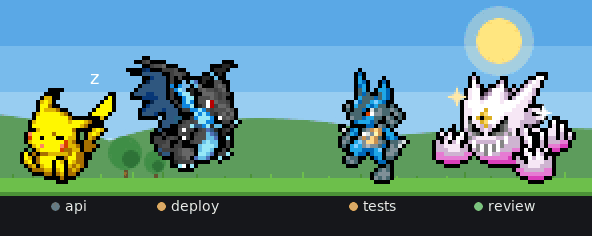
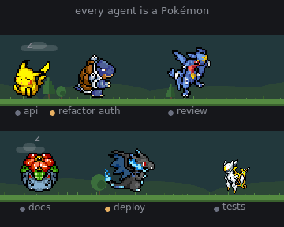
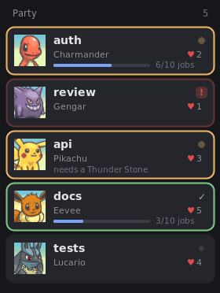
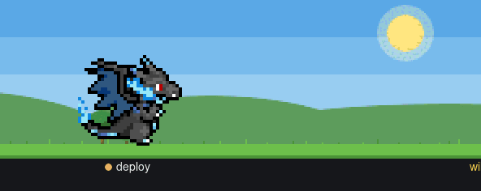
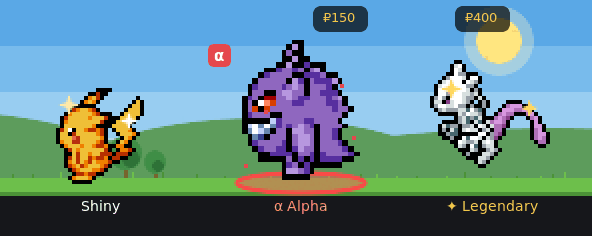
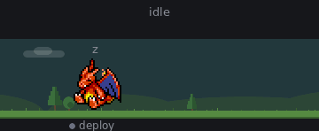

# Pokerdr: Pokémon Trainer

**Every coding agent in [Herdr](https://herdr.dev) becomes a pixel-art Pokémon, and your agents'
work turns into a Pokémon game.** It walks while its agent works, naps when it's idle, and calls
for you when it's blocked. Meanwhile wild Pokémon walk by to battle and catch.

<p align="center"></p>

## Highlights

- 🐾 **974 Pokémon** and 104 forms (regional ones, Rotom's appliances, Giratina Origin, Shaymin Sky, the Therians…), each with its own types; the picker shows every one's types and filters by up to two. **Mega Evolution** while an agent works or battles (stronger as a Mega), shinies.
- 🎯 **Catch wild Pokémon** walking across the strip with Poké Balls and Berries.
- ⚔️ **Battle them first**: real base stats and the full type chart ("It's super effective!").
  They hit back.
- ✦ **Legendaries** locked until you catch one; **Alphas** α, bigger and tougher.
- 📋 **Daily Research**: three tasks from your work; finish all three for an Azure Flute that calls a legendary when you're ready.
- ₽ **Pokédollars** from your agents' work, a **Shop**, a **Box**, a **Pokédex**.
- 💗 **Hearts and evolution** that grow with your agents: 15 jobs then 30, a stone, friendship. A Rare Candy is 5 jobs.
- 🗂 **Pokémon Sidebar**: your agents as cards with their Pokémon.

<p align="center">
  
  
</p>

## How to play

| | |
|---|---|
| **Your herd** | Each agent is a Pokémon. **Click** it to go to its agent; **right-click** for its menu: use an item on it, bring out one waiting in the Box, or choose another kind. |
| **Wild Pokémon** | One walks by every few minutes. **Click** it for its gift and ₽; **click again** to throw a ball. |
| **Weaken it** | **Drag** one of yours onto it: they battle, and a health bar shows. Lower health, easier catch (up to ×2). **Stop at the red**, or it may faint. |
| **Balls & Berries** | Poké, Great ×1.5, Ultra ×2, Master (never fails). A Berry before each ball: Razz ×1.5, Golden Razz ×2.5, Pinap for twice the gift. On Auto, the best ball and Berry go to rare ones, and a rare one cries as it walks in. |
| **Raids** | Every 2½ hours of your agents' work, all together, in a day (2 at most), an egg hatches into a big boss (an Alpha, now and then a legendary). Drag your Pokémon onto it to hit it, each once a minute (harder while its agent works); the boss strikes back and throws it off. Beat it in 30 minutes for ₽300 and 3 Ultra Balls, then catch it. |
| **Mass Outbreak** | Once a day, for 20 minutes, one species keeps walking by; shinies 1 in 16. |
| **Box** | Sort it, Lock (🔒) the ones you love, and release many at once (Select → Duplicates keeps the best of each species). Each one released leaves ₽10, ₽50 for a shiny or an Alpha. |
| **Rare ones** | Shiny 1 in 64 · Alpha 1 in 40 (½ as easy, ₽150, ♥2) · Legendary 1 in 150, or call one with the Azure Flute. |
| **Today** | Three Research tasks a day, each paying ₽ or balls; all three: 5 Ultra Balls and an Azure Flute (call a legendary when you're watching). |
| **Pokédollars** | Jobs pay ₽1 + ₽5 a minute (about ₽300 an hour of agents' work). Shop via **☰ in the strip's corner (or right-click the ground) → Box → Shop**. Anything sells back for half. |
| **Hearts** | Pats, quick answers, spars and Berries (three a day). Most evolve after 15 jobs, then 30 more; a Rare Candy counts for 5. |

Everything else is one right-click on the strip's ground away: the **Box** (with the Bag, Shop,
Today and Pokédex), the ball and Berry to throw, and **Settings** (with a **Guide** tab).

## Battle to catch

<p align="center"></p>

A wild Pokémon at full health is hard to catch. **Drag one of yours onto it** and they battle:

- **The faster moves first** (Speed, as the games: its nature and how it's raised count), then
  the other strikes back. **Damage** comes from real base stats (your Pokémon's best attack
  against its best defence) and the full type chart, both types: *"It's extremely effective!"* (×4), *"It's super
  effective!"* (×2), *"It's not very effective…"*, *"It doesn't affect…"* (×0).
- **Movesets from the games.** Each Pokémon knows four of 90 moves, the ones it really learns
  levelling up (from PokeAPI's learnsets): two of its own types (one of each, if it has two) and
  two for coverage. Charizard: Flamethrower, Air Slash, Dragon Claw, Crunch; Gallade: Psycho Cut,
  Focus Blast, Leaf Blade, Draining Kiss; Caterpie just Bug Bite and Tackle. The picker, its preview
  and the Box show each one's moves; **Change** lets you teach yours any of the moves it really
  learns (weak ones and signature moves too, Gallade's Close Combat), four at most; a Mega has
  its own four (Mega Charizard X: Outrage), to change apart. A weak move
  (Tackle, Ember) is never one it starts with unless it knows nothing else. Legendaries and a few others
  have their own move, as in the games: Arceus's Judgment takes the type that hits hardest,
  Mewtwo's Psystrike, Dialga's Roar of Time, Pikachu's Volt Tackle, Meowscarada's Flower Trick (always
  a critical hit) and 40 more. Every move has its own look, from Ember's sparks to
  Hydro Pump's torrent and Fire Blast's five-pointed burst. Damage as the
  games reckon it: each move's power, Attack against Defense or Sp. Atk against Sp. Def, HP,
  STAB, the type chart; now and then a signature move (Blast Burn, Thunder), 1 in 16 "A critical
  hit!", and misses as often as each move's accuracy says (Thunder 3 in 10, Swift never; in the rain Thunder never misses, in the sun it's a coin toss). Physical moves rush in (streaks behind, each its own mark: Fire Punch's
  fist of flame, Crunch's jaws), special ones fire their own way (Flamethrower's stream, Surf's wave).
- **Moves you can see.** Yours steps off a little, gathers power and uses its best type against
  it, each move its own way: Flamethrower a stream of fire, Surf a wave, Thunderbolt a jagged
  bolt, Ice Beam a beam that freezes, Sludge Bomb globs lobbed over, Moonblast a moon… A hit
  flashes, throws sparks and knocks it back, the damage floats up and the health bar drains; a
  super-effective one shakes it. Sounds too, a click away (🔇 in the strip's corner). Megas and regional forms fight with their own types
  and stats (Mega Charizard X: Fire/Dragon, blue fire).
- **Sparring is a real battle.** Two of yours (now and then by themselves, or one dropped on
  another) take turns with named moves, health bars and all, till one is down or after three
  turns each. The faster moves first, and moves do what they do in the games: Thunderbolt can
  paralyse, Flamethrower burn, Ice Beam freeze, Sludge Bomb poison, Air Slash make it flinch,
  Crunch lower its Defense. All are level 50; a well-raised one is a touch stronger (+1% a heart, +5%
  at most, like Legends: Arceus' effort levels), and its nature counts (Brave: more Attack, less Speed). The winner celebrates ("Landorus won! 3–1", the two's record today), the other sits
  dizzy, nobody is hurt for real. The winner gains a little more friendship; the Box keeps each
  one's record, and those idle nearby turn to watch.
- **Trainers come by.** Now and then a trainer (a Hiker, a Swimmer, a Black Belt, a Punk…) walks
  to the strip's corner, throws out its Pokémon and wants to battle (for 3 minutes): two or three
  fully evolved ones of its types, now and then a legendary, a Mega or an Alpha among them, its
  team as balls under its feet. Beat them one after another for a few Pokédollars and a ball or a
  Berry (now and then a fine gift: a Rare Candy, an Azure Flute…); it says a word and walks off.
  Win, and it cheers instead.
- **Eight badges**, as the games' Kanto ones, each for a goal of the game (10 jobs, 10 kinds
  caught, a Pokémon evolved, 100 jobs, one with 5 hearts, 10 trainers beaten, the Battle Tower's
  7th floor, 150 kinds caught), each with an item to hold the first time, and a small perk for
  good, as the games' badges raised a stat: yours' moves or Speed +3%, catching +5%, finding
  things sooner, trainers paying 10% more, shinies a little likelier. The Bag shows each one's.
- **The Battle Tower** (☰ menu): trainers one after another, as long as you keep winning, each a
  little stronger. Three lives (as many as your Pokémon, if fewer), one heal a floor, no healing
  by itself in it, and one swapped in from the Box comes in hurt. Each floor pays once a day, with
  a ball or a Berry, and every 7th a bigger gift; the Today tab keeps your best.
- **Wild ones have their ways.** About 1 in 4 do something on the way: Gengar sneaks up and
  pokes one of yours awake, Snorlax naps halfway (easier to catch, cross if you wake it), Abra
  teleports out of a missed ball, Machop picks a fight, Eevee stops to say hello, a Fire type
  basks on a sunny day, a fast one dashes across.
- **It hits back.** Yours has a health bar too; at 0 it faints and rests 10 minutes (no hearts
  lost), or a **Revive** brings it back at once. Berries heal one that's hurt. Pick a strong
  attacker with a good type.
- **Watch the bar.** The weaker it is, the easier the catch, up to **×2**. A hit a little more than
  its health leaves it a sliver; a hit **twice its health or more** knocks it out, and in the red
  **half again** (20% left and a 30% hit: gone). The bar blinks red when the next hit may be too much. Then throw.

| Ball | ×  | Berry (before each ball) | Effect |
|---|---|---|---|
| Poké Ball | 1 | Razz | ×1.5 |
| Great Ball | 1.5 | Golden Razz | ×2.5 |
| Ultra Ball | 2 | Pinap | twice the gift |
| Master Ball | never fails | Silver Pinap | ×1.8 and twice the gift |

## Rare Pokémon

<p align="center"></p>

| | How often | What's special |
|---|---|---|
| ✨ **Shiny** | 1 in 64 (1 in 32 with the Shiny Charm, at 500 jobs) | Another colour. Catch one and you can choose that species shiny in the picker. |
| α **Alpha** | 1 wild one in 40 | Bigger, a red ring and α. Half as easy to catch and tougher in battle; carries ₽150 and twice the gift. Caught, it stays an Alpha: ♥2, hits harder, takes less. |
| ☾ **Shadow Alpha** | 1 Alpha in 3 | A dark violet aura. Hits and takes ×1.2. Caught, purify it in the Box once it has ♥4: it stays an Alpha, gains a heart and ₽100. |
| ⇕ **XXL / XXS** | 1 wild one in 40 each (XL / XS 1 in 8) | Not stronger: an XXS is hard to hit (moves miss it 1 in 8), an XXL is heavy (knocked back less, knocks the other further). Caught, it keeps its size (in the Box); the Pokédex keeps each species' biggest and smallest, and one that would beat it says so under its feet. |
| ✦ **Legendary** | 1 wild one in 150, or called by the **Azure Flute** (₽1,000) (one for finishing the day's Research) | Mewtwo, Rayquaza… always one you haven't caught yet, till you have them all. Locked in the picker until you catch one. Very hard: it walks slowly, and you have 20 balls before it runs away. |

**Genders.** Each Pokémon is ♂ or ♀ as its species is in the games (Chansey always ♀, Tauros
always ♂, Magnemite neither). 59 species look different as females, and the strip draws them so:
Pikachu's heart-tipped tail, Venusaur's seed. Some evolve by gender: Kirlia ♂ into Gallade, Snorunt
♀ into Froslass, only a female Combee into Vespiquen. The Pokédex counts species caught as both.

**Weather.** The strip's sky boosts some types, as in Pokémon GO: rain (an agent waiting on you)
Water, Electric and Bug; night Dark, Ghost and Poison; by day the season: spring Fairy, Normal and
Flying, summer Fire, Grass and Ground, autumn Dragon, Psychic and Fighting, winter Ice, Steel and
Rock. Their moves hit ×1.2 (the weather's icon by the move's name) and more of them walk by. The
Today tab says which.

<p align="center"></p>

## Install

You need [Herdr](https://herdr.dev), `curl`, and ImageMagick (`magick` or `convert`).

The easiest way: ask your agent in Herdr to add `herdr.dev/mods/lntvan166/herdr-pokemon`. Or by hand:

```sh
git clone https://github.com/lntvan166/herdr-pokemon
cd herdr-pokemon
scripts/install.sh   # copies mods/pokemon-herd and mods/pokemon-sidebar into ~/.config/herdr-app/mods/
```

A strip appears at the bottom of the window, and new players get Pokémon Sidebar. Right-click the
strip's ground → **Settings** to move it, resize it, or give it more rows.

Optional keys (`keys.json`): `"alt-shift-p": "pokemon-herd.pick"` (picker for the focused agent),
`"alt-shift-b": "pokemon-herd.bag"` (the Bag).

## Updating

It updates itself: every few hours the strip checks GitHub, installs a newer version and says
"✓ Updated to …" in its corner. Your Pokémon, Bag, money and Pokédex stay. Turn it off in
**Settings → Updates → Update by itself**; then an **Update** pill shows and **Update now** installs
it. If it can't, Settings → Updates says why and shows how to update by hand.

**On 2.16.1 to 2.20.0, update by hand once:** those versions' updater fails ("TextDecoder is not
defined"), so they can't install the fix by themselves. Ask your agent: *Read
~/.config/herdr-app/AGENTS.md, then update the Pokerdr mod from
https://github.com/lntvan166/herdr-pokemon*. Or on macOS and Linux (the mod in its usual folder):

```sh
cd /tmp && curl -sfL https://codeload.github.com/lntvan166/herdr-pokemon/tar.gz/refs/heads/main | tar -xz \
  && cp -R herdr-pokemon-main/mods/pokemon-herd/. ~/.config/herdr-app/mods/pokemon-herd/ \
  && mkdir -p ~/.config/herdr-app/mods/pokemon-sidebar \
  && cp -R herdr-pokemon-main/mods/pokemon-sidebar/. ~/.config/herdr-app/mods/pokemon-sidebar/
```

From a clone of this repo: `git pull && scripts/install.sh`.

## Art and names

- Sprites and portraits: [PMD SpriteCollab](https://github.com/PMDCollab/SpriteCollab) by the
  PMDCollab artists, CC BY-NC 4.0, downloaded on first use. The demo images here are drawn from
  them by `scripts/make-demos.py`.
- Names, evolutions, base stats and types: [PokeAPI](https://github.com/PokeAPI/pokeapi)'s CSVs
  (`scripts/gen-species.mjs`, `scripts/gen-stats.mjs`). Item and badge art: PokeAPI's sprites.
- Trainers' pictures and the scenery's (trees by season, bushes, rocks, flowers, the campfire):
  drawn for Pokerdr with ChatGPT's image generation, in the sprites' style.
- Pokémon Sidebar is a fork of [Better Sidebar](https://github.com/munza/herdr-mods) by Tawsif
  Aqib (Apache-2.0).
- Pokémon and all related names are trademarks of Nintendo, Creatures and GAME FREAK. This is an
  unofficial fan project, not affiliated with them.

## Where this comes from

It started as a copy of
**[mathieucroset/herdr-pokemon-agents](https://github.com/mathieucroset/herdr-pokemon-agents)**
(MIT, v0.2.0; its changelog: [docs/upstream-CHANGELOG.md](docs/upstream-CHANGELOG.md)). It is now
its own mod and installs next to the upstream one without clashing; agents coming from it keep
their Pokémon.

## Develop

`npm test` runs the tests (Node ≥ 20). `scripts/install.sh` copies the mods into Herdr, which
hot-reloads them. [RECIPE.md](RECIPE.md) describes the whole mod in detail. Contributions are
welcome: see [CONTRIBUTING.md](CONTRIBUTING.md); questions and ideas go to
[Discussions](https://github.com/lntvan166/herdr-pokemon/discussions).

## License

Code: MIT (see [LICENSE](LICENSE)); Pokémon Sidebar: Apache-2.0 (its own LICENSE and NOTICE). The
demo images: CC BY-NC 4.0, after PMD SpriteCollab.
