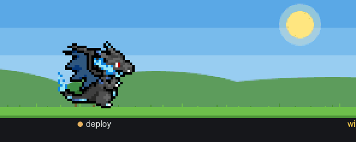
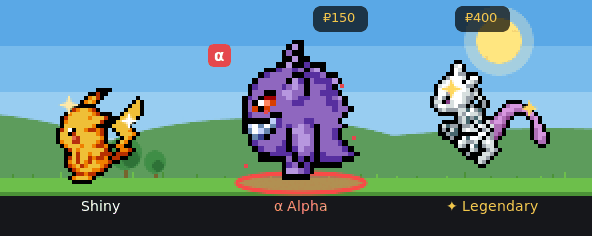

# Pokerdr: Pokémon Trainer

**Every coding agent in [Herdr](https://herdr.dev) becomes a pixel-art Pokémon, and your agents'
work turns into a Pokémon game.** It walks while its agent works, naps when it's idle, and calls
for you when it's blocked. Meanwhile wild Pokémon walk by to battle and catch.

<p align="center"></p>

## Highlights

- 🐾 **974 Pokémon**, regional forms, **Mega Evolution** while an agent works or battles (stronger as a Mega), shinies.
- 🎯 **Catch wild Pokémon** walking across the strip with Poké Balls and Berries.
- ⚔️ **Battle them first**: real base stats and the full type chart ("It's super effective!").
  They hit back.
- ✦ **Legendaries** locked until you catch one; **Alphas** α, bigger and tougher.
- 📋 **Daily Research**: three tasks from your work; finish all three and a legendary appears.
- ₽ **Pokédollars** from your agents' work, a **Shop**, a **Box**, a **Pokédex**.
- 💗 **Hearts and evolution** that grow with your agents: 15 jobs then 30, a stone, friendship. A Rare Candy is 5 jobs.
- 🗂 **Pokémon Sidebar**: your agents as cards with their Pokémon.

<p align="center">
  
  
</p>

## How to play

| | |
|---|---|
| **Your herd** | Each agent is a Pokémon. **Click** it to go to its agent; **right-click** to choose another (click to preview, **Replace** to take it). |
| **Wild Pokémon** | One walks by every few minutes. **Click** it for its gift and ₽; **click again** to throw a ball. |
| **Weaken it** | **Drag** one of yours onto it: they battle, and a health bar shows. Lower health, easier catch (up to ×2). **Stop at the red**, or it may faint. |
| **Balls & Berries** | Poké, Great ×1.5, Ultra ×2, Master (never fails). Set a Berry before each ball: Razz ×1.5, Golden Razz ×2.5, Pinap for twice the gift. |
| **Rare ones** | Shiny 1 in 64 · Alpha 1 in 40 (½ as easy, ₽150, ♥2) · Legendary 1 in 150, or call one with the Azure Flute. |
| **Today** | Three Research tasks a day, each paying ₽ or balls; all three: 5 Ultra Balls and a legendary. |
| **Pokédollars** | Jobs pay ₽1 + ₽5 a minute (about ₽300 an hour of agents' work). Shop via **right-click the ground → Box → Shop**. Anything sells back for half. |
| **Hearts** | Pats, quick answers, spars and Berries (three a day). Most evolve after 15 jobs, then 30 more; a Rare Candy counts for 5. |

Everything else is one right-click on the strip's ground away: the **Box** (with the Bag, Shop,
Today and Pokédex), the ball and Berry to throw, and **Settings** (with a **Guide** tab).

## Battle to catch

<p align="center"></p>

A wild Pokémon at full health is hard to catch. **Drag one of yours onto it** and they battle:

- **Damage** comes from real base stats (your Pokémon's best attack against its best defence)
  and the full type chart, both types: *"It's extremely effective!"* (×4), *"It's super
  effective!"* (×2), *"It's not very effective…"*, *"It doesn't affect…"* (×0).
- **It hits back.** Yours has a health bar too; at 0 it faints and rests 10 minutes (no hearts
  lost). Pick a strong attacker with a good type.
- **Watch the bar.** The weaker it is, the easier the catch, up to **×2**. A hit just a little
  more than its health leaves it a sliver; a hit **twice its health or more** knocks it out
  (30% left and a big hit: gone). The bar blinks red when the next hit may be too much. Then throw.

| Ball | ×  | Berry (before each ball) | Effect |
|---|---|---|---|
| Poké Ball | 1 | Razz | ×1.5 |
| Great Ball | 1.5 | Golden Razz | ×2.5 |
| Ultra Ball | 2 | Pinap | twice the gift |
| Master Ball | never fails | Silver Pinap | ×1.8 and twice the gift |

## Rare Pokémon

<p align="center"></p>

| | How often | What's special |
|---|---|---|
| ✨ **Shiny** | 1 in 64 (1 in 32 with the Shiny Charm, at 500 jobs) | Another colour. Catch one and you can choose that species shiny in the picker. |
| α **Alpha** | 1 wild one in 40 | Bigger, a red ring and α. Half as easy to catch and tougher in battle; carries ₽150 and twice the gift. Caught, it stays an Alpha: ♥2, hits harder, takes less. |
| ✦ **Legendary** | 1 wild one in 150, or called by the **Azure Flute** (₽1,000) or by finishing the day's Research | Mewtwo, Rayquaza… Locked in the picker until you catch one. Very hard: 15 balls before it runs away. |

<p align="center"></p>

## Install

You need [Herdr](https://herdr.dev), `curl`, and ImageMagick (`magick` or `convert`).

The easiest way: ask your agent in Herdr to add `herdr.dev/mods/lntvan166/herdr-pokemon`. Or by hand:

```sh
git clone https://github.com/lntvan166/herdr-pokemon
cd herdr-pokemon
scripts/install.sh   # copies mods/pokemon-herd and mods/pokemon-sidebar into ~/.config/herdr-app/mods/
```

A strip appears at the bottom of the window, and new players get Pokémon Sidebar. Right-click the
strip's ground → **Settings** to move it, resize it, or give it more rows.

Optional keys (`keys.json`): `"alt-shift-p": "pokemon-herd.pick"` (picker for the focused agent),
`"alt-shift-b": "pokemon-herd.bag"` (the Bag).

## Updating

The strip checks once a day and shows an **Update** pill when a new version is out. Right-click
the ground → **Settings → Updates → Update now**. Your Pokémon, Bag, money and Pokédex stay. By
hand: `git pull && scripts/install.sh`.

## Art and names

- Sprites and portraits: [PMD SpriteCollab](https://github.com/PMDCollab/SpriteCollab) by the
  PMDCollab artists, CC BY-NC 4.0, downloaded on first use. The demo images here are drawn from
  them by `scripts/make-demos.py`.
- Names, evolutions, base stats and types: [PokeAPI](https://github.com/PokeAPI/pokeapi)'s CSVs
  (`scripts/gen-species.mjs`, `scripts/gen-stats.mjs`). Item and badge art: PokeAPI's sprites.
- Pokémon Sidebar is a fork of [Better Sidebar](https://github.com/munza/herdr-mods) by Tawsif
  Aqib (Apache-2.0).
- Pokémon and all related names are trademarks of Nintendo, Creatures and GAME FREAK. This is an
  unofficial fan project, not affiliated with them.

## Where this comes from

It started as a copy of
**[mathieucroset/herdr-pokemon-agents](https://github.com/mathieucroset/herdr-pokemon-agents)**
(MIT, v0.2.0; its changelog: [docs/upstream-CHANGELOG.md](docs/upstream-CHANGELOG.md)). It is now
its own mod and installs next to the upstream one without clashing; agents coming from it keep
their Pokémon.

## Develop

`npm test` runs the tests (Node ≥ 20). `scripts/install.sh` copies the mods into Herdr, which
hot-reloads them. [RECIPE.md](RECIPE.md) describes the whole mod in detail. Contributions are
welcome: see [CONTRIBUTING.md](CONTRIBUTING.md); questions and ideas go to
[Discussions](https://github.com/lntvan166/herdr-pokemon/discussions).

## License

Code: MIT (see [LICENSE](LICENSE)); Pokémon Sidebar: Apache-2.0 (its own LICENSE and NOTICE). The
demo images: CC BY-NC 4.0, after PMD SpriteCollab.
