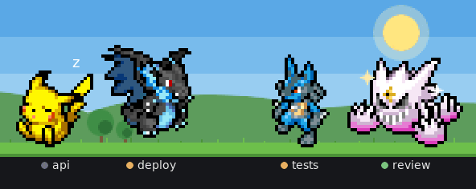
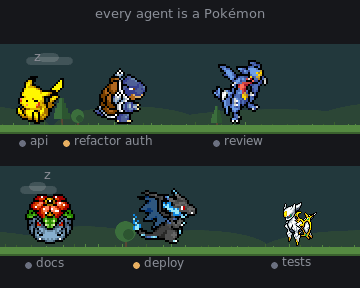
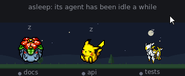
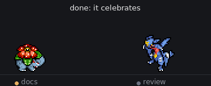
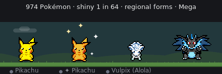
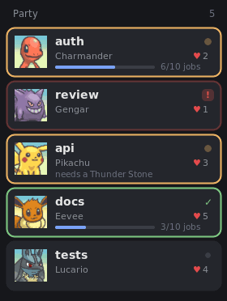
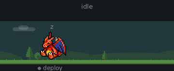
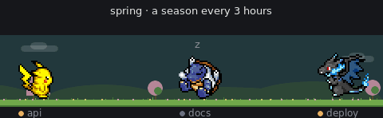

# herdr-pokemon

Every coding agent in [Herdr](https://herdr.dev) becomes a pixel-art Pokémon. It walks while
its agent works, naps when it's idle, and calls for you when it's blocked. Click one to jump
to its agent.

<p align="center"></p>

<p align="center"></p>

A Herdr mod, `pokemon-herd`. It started as a copy of
[mathieucroset/herdr-pokemon-agents](https://github.com/mathieucroset/herdr-pokemon-agents)
(see [Where this comes from](#where-this-comes-from)).

## What it does

**They react to you and to their agents.** Click an agent, or focus its pane, and its Pokémon
wakes up and looks at you, then stays up 15 s. When its agent finishes, it celebrates. When the
agent needs you, it startles and calls. When the agent starts working, it gets ready to go. Idle ones mind the season: they sniff
the spring flowers 🌸, bask in the summer sun ☀️, look up at the falling leaves 🍂 and shiver in
the snow ❄️, and they fall asleep sooner at night. Hover
one and it turns to you, and its name shows what it has done: "Pikachu · api · ♥2 · 7 jobs".

<p align="center">
  
  
</p>

**974 Pokémon, a few surprises.** Every agent gets a random Pokémon from all those with a
walking animation, and keeps it. Close an agent and open a new one in the same folder, and it
gets that folder's Pokémon back, hearts, jobs and all (each folder its own; a subfolder is another). Now and then one is **shiny** (1 in 64). Right-click one, or
press `alt-shift-p` for the focused agent, to pick another: search by name, number or region,
or scroll through them all; **right-click** one to preview it (standing, walking, asleep, shiny) before choosing. **☆ Favorite** in that preview makes it a **favourite** (★) (or
the card's ☆ Favorite, for the one it is now); the ★ chip lists your favourites, and Settings → New agents' Pokémon → Favorites gives each new agent one
of them. Narrow it to the ones that can **Mega** Evolve, or to one **region**
(Kanto to Paldea, forms included), or roll **🎲 Random** among what's shown (it prefers a
Pokémon nobody else on screen has). The **regional forms** (Alola, Galar, Hisui, Paldea) are there too.

<p align="center"></p>

**Evolution, the way the games do it.** Most Pokémon evolve after their agent finishes 10 jobs
(Charmander, then Charmeleon, then Charizard), with a sparkle. Others need what they need in the
games: a **stone** (Pikachu takes a Thunder Stone; Eevee becomes whichever its stone says),
**friendship** (Pichu, Riolu, Golbat at 5 ♥), or the **time of day** (Eevee with full hearts is
Espeon by day and Umbreon at night; Gligar evolves at night). Give one an **Everstone** to keep it
as it is. Deerling and Sawsbuck change coats with the season.

**Hearts, and the Bag.** Friendship is points, 20 to a heart, 5 hearts at most, and it comes
slowly: a click on a Pokémon (+3, every 30 minutes at most), an answer to its agent within a
minute (+4, every 10 minutes at most), sparring (+3), a Berry (+10). Leave its agent waiting over
5 minutes and it gets hungry (😢, −10) until you answer, when it eats a Berry if you have one. Idle Pokémon now and then dig something up: Berries,
stones, a Rare Candy. A job over 30 minutes earns a Rare Candy too (it evolves one now). Use them in
the picker or in the **Bag** (right-click the strip, "Bag"): pick an item and it lists who on
screen can take it now and what each would become, with a Use button. The picker shows who it is, its hearts, what its species has done, its evolution line (click
one to switch) and what it takes to evolve. The Bag also holds the **8 badges**
(10 jobs, 100, a first evolution, 24 hours of work, 5 hearts, a job finished after midnight, a job
over an hour, 1000 jobs); each badge, the first time, comes with an item to hold: a **Lucky Egg**
(jobs count twice towards evolving), a **Soothe Bell** (hearts come twice as fast) or an **Amulet
Coin** (it finds things twice as often), **Leftovers** (it never goes hungry) or an **Exp. Share**
(each job its agent finishes also counts for the Pokémon furthest from evolving). **Honey**, used
from the Bag, calls a visitor over at once. At 500 jobs you get the **Shiny Charm**: shinies twice as
often.

**Agent cards.** On by default for a new player (in the sidebar; on one of Herdr's built-in
layouts a copy of it is made first, yours to change). Settings → Agent cards → **Sidebar**, and every agent is its Pokémon's card: the
agent's name, large; the card's edge in its status colour (working, done, pulsing red while it
needs you); its Pokémon, hearts and how close it is to evolving. Click one to focus that agent.
It changes the sidebar you have rather than adding to it: Herdr's own Agents list is drawn as
cards, in the same place, in its sections (Needs you, Done, Working, Idle); with
[Better Sidebar](https://herdr.dev/mods), its own rows become the cards (it gets a small patch,
applied for you). **Right panel** puts the same list in the right panel instead. Off by
default; turning it off puts everything back as it was. In a collapsed sidebar the cards shrink
to a column of portraits.

<p align="center"></p>

Herdr's built-in layouts (`main`, …) can't be changed by a mod: Settings shows **Make it mine**,
which copies the layout you're on into one you own (and shows it) so the cards and the strip's
place, rows and size can be set.

**Pokédollars and the Shop.** Every job an agent finishes pays: ₽5 and ₽2 a minute it took
(₽150 at most), twice for a Pokémon holding an Amulet Coin, with "+₽25" over its head. The Bag's
**Shop** tab sells every item (Oran Berry ₽30, Honey ₽200, stones ₽500, Rare Candy ₽800, items to
hold ₽1,500) and five for the whole herd: **X Speed** (₽200, 10 min: faster, hardly stopping),
**Poké Flute** (₽150: wakes everyone and keeps them up 10 min), **X Attack** (₽300, 10 min:
sparring and teasing again and again), **Soda Pop** (₽150, 10 min: three times the fidgets, and
dancing) and the **Festival Ticket** (₽250: fireworks, and everyone celebrates). Boosts on now show
as small pills in the strip's corner with the minutes left. A Bag from before Pokédollars was
paid once for the jobs already done.

**The Box.** (Its tab in the Bag lists the ones with agents and the ones waiting; Take what one holds, Rename it, Bring one out for an agent you choose, or Release it.) Close an agent and its Pokémon goes to the Box with its hearts, jobs, item and
shiny luck. The next agent to get that species (you pick it, or a new agent is given it) gets
that very Pokémon back; it moves over, so an item is never doubled. In the picker, **📦 Box it**
puts the current one in the Box and makes your next pick a new one (1 in 64 shiny: hunt for one,
or swap a shiny for a plain one); right-click a species and **Bring out** a particular one from
the Box.

**Napping, not frozen.** An agent left idle puts its Pokémon to sleep, but now and then it wakes
up, stretches, wanders a little and dozes off again (less often at night).

**Visitors.** Every few minutes a wild Pokémon nobody has (once in a while a shiny) walks across
the strip and is gone; idle ones turn to watch it pass. Hover it: "A wild Pidgey". Settings →
Visitors sets how often: Off, Rare (every 10–25 minutes), Often (3–8, the default) or Lots (1–3). Each
carries a gift (🎁 over its head): click it as it passes and it leaves you something for the Bag
(a Berry mostly, now and then a stone).

**A campfire, and combos.** At night, once no agent is working or waiting on you, a fire is lit
in the middle of the strip and the herd sleeps round it (Settings → Campfire). An agent and its
sub-agent, both working, now and then attack together, side by side (⚡).

**Notifications, rivals, and a tired herd.** Settings → "Pokémon in notifications" (needs a layout
of your own) draws Herdr's notifications with the agent's Pokémon: "review · Gengar · needs you".
Two agents working in the same folder at once may edit each other's files: their Pokémon show
⚔️, and their cards say "⚔ same folder as …". With the Usage Limits mod, from 90% of the 5-hour
window the herd sweats 💦 and walks slower. An agent's card says what it's doing while it works.

**Weather, sparring, sub-agents, cries.** The sky rains while an agent waits on you, and storms
when three do or one has waited 10 minutes; when the last one is answered, a rainbow. Two idle Pokémon standing close now and then spar
(a heart each): they trade blows face to face, then one throws its special move, its type flying
across (🔥 💧 ⚡ 👻 …), and now and then one walks over to a sleeping one and pokes it awake for a go.
Idle ones also fidget: nod, sit, look up, twirl, strike a pose, whatever their sprite can do. A sub-agent shows as its agent's Pokémon, younger and smaller (Alakazam's helper
is an Abra), tagged "↳ tab", and follows it. Each Pokémon can cry, its real cry, when its agent
needs you or finishes: off by default, in **Settings** (needs `ffmpeg`).

**Mega Evolution.** About 40 species can Mega Evolve. Each one's picker has a Mega setting: Off,
On, or Auto. On Auto, it Mega Evolves while its agent works and turns back when the agent is
done. New Megas show up by themselves as SpriteCollab draws them (the mod checks once a day).
Mega X / Y: pick one in the picker once both are drawn.

<p align="center"></p>

**A herd that stays readable.**
- Every name sits under its own Pokémon. It is cut with "…" when space is tight, and drops to a
  second line when two would collide. A name is never hidden.
- Resting Pokémon spread out to make room for their names.
- The ground lines stay put: the strip never jumps up and down.

**Yours to arrange.**
- Right-click the strip's ground for the **Bag** and **Settings**. Settings (it stays open while
  you change things) has where the strip sits (sidebar, bottom of the window, right panel), its
  size (Tiny, Small, Medium, Large; Small by default), 1–3 rows, the background, agent cards,
  the cries, and a switch for each of evolution, Pickup, weather, sparring and sub-agents.
- The background is **Scenery** by default: sky, hills, trees and grass. It shows day or night by your
  clock, with clouds by day and stars and moon by night, and it never draws behind the names.
  It is muted in a dark theme and pale in a light one. The seasons turn every 3 hours: spring
  blossom, summer green, gold autumn with falling leaves, then snow, a step further on each day.

  **Sky: Bright** (Settings) makes it a real day instead: a blue sky in pixel bands, white clouds,
  the sun crossing it by your clock, an orange and violet sunset and sunrise, a deep blue night.
  Switch it to **Plain** in Settings.
- **Stats:** each species counts the jobs its agents finished and the time they spent working.
  Two agents that are both Pikachu add to Pikachu's. The Bag shows the totals and the three
  busiest species.
- The rows form one track: walk off the right edge of one and you turn up on the left of the next.
- Drag a Pokémon to move it, or to change its row. Drop it on a sleeping one and it pokes it
  awake for a spar; on one awake, they spar there and then. Shake it about and it reels, dizzy.

<p align="center"></p>

## Install

You need [Herdr](https://herdr.dev), `curl`, and ImageMagick (`magick` or `convert`).

In Herdr, the easiest way is to ask your agent to add `herdr.dev/mods/lntvan166/herdr-pokemon`
(it follows [RECIPE.md](RECIPE.md), and tells you how to use it when it's done). Or by hand:

```sh
git clone https://github.com/lntvan166/herdr-pokemon
cd herdr-pokemon
scripts/install.sh   # copies mods/pokemon-herd into ~/.config/herdr-app/mods/ and checks it
```

Herdr docks a strip at the bottom of the window the first time it sees the mod. Right-click
its ground, then Settings, to give it more rows or move it to the sidebar. Built-in layouts must be cloned
first (`layout.clone`). To place it yourself instead, add a block to a layout you own:

```json
{ "id": "pokemon-herd", "type": "block", "content": { "mod": "pokemon-herd", "props": { "scale": 0.75, "rows": 2 } }, "size": { "px": 216 } }
```

Optional, in `keys.json`: `"alt-shift-p": "pokemon-herd.pick"` opens the picker for the
focused agent, and `"alt-shift-b": "pokemon-herd.bag"` opens the Bag.

The mod downloads sprites as it needs them into `~/.config/herdr-app/data/pokemon-herd/`.
If you are coming from the upstream `pokemon-agents` mod, your agents keep their Pokémon.

## Updating

Once a day the strip checks this repo, and when a newer version is out it shows a small
**Update** pill in its corner. Opening **Settings** checks again right then. Right-click the ground → **Settings** → Updates → **Update now**:
it downloads the release and copies it over the mod's folder, and Herdr reloads it (it needs
`curl` and `tar`). Or by hand:

- **Installed by your agent:** delete `~/.config/herdr-app/mods/pokemon-herd/`, then ask it to
  add `herdr.dev/mods/lntvan166/herdr-pokemon` again. Without the delete it adds a second copy
  under another name.
- **Cloned by hand:** `git pull && scripts/install.sh`.

Your agents keep their Pokémon, shinies, Mega settings, hearts, Bag and badges, since those live
in Herdr's shared state and not in the mod's folder. New Megas need no update: the mod picks them up as
SpriteCollab draws them.

## Art and names

- Sprites and portraits: [PMD SpriteCollab](https://github.com/PMDCollab/SpriteCollab) by the
  PMDCollab artists, CC BY-NC 4.0. Each sprite's credits are in their repo. The mod downloads
  them on first use.
- The demo GIFs above are drawn from those sprites (same credits and licence) by
  `scripts/make-demos.py`. They are the only Pokémon art in this repo.
- Names and how each species evolves come from [PokeAPI](https://github.com/PokeAPI/pokeapi)'s
  CSVs (`pokemon_species_names`, `pokemon_species`, `pokemon_evolution`, `items`).
  `node scripts/gen-species.mjs` bakes them into `mods/pokemon-herd/species.js`.
- The Bag's item and badge art is [PokeAPI's sprites](https://github.com/PokeAPI/sprites),
  downloaded on first use.
- Pokémon and all related names are trademarks of Nintendo, Creatures and GAME FREAK. This is
  an unofficial fan project, not affiliated with them.

## Where this comes from

The original idea and implementation are
**[mathieucroset/herdr-pokemon-agents](https://github.com/mathieucroset/herdr-pokemon-agents)**
(MIT, commit `93e86ad`, v0.2.0). Its changelog is in
[docs/upstream-CHANGELOG.md](docs/upstream-CHANGELOG.md), and its license and copyright stay in
[LICENSE](LICENSE). This is now its own mod, and it installs next to the upstream one without
clashing.

## Develop

`npm test` runs the tests for the pure modules (Node ≥ 20). The pure modules are: species and
picks, name-tag layout, reactions, resting spots, row wrapping, and placement.
`scripts/install.sh` copies the mod into Herdr, which hot-reloads it.

## License

Code: MIT (see [LICENSE](LICENSE)). The demo GIFs: CC BY-NC 4.0, after PMD SpriteCollab.
