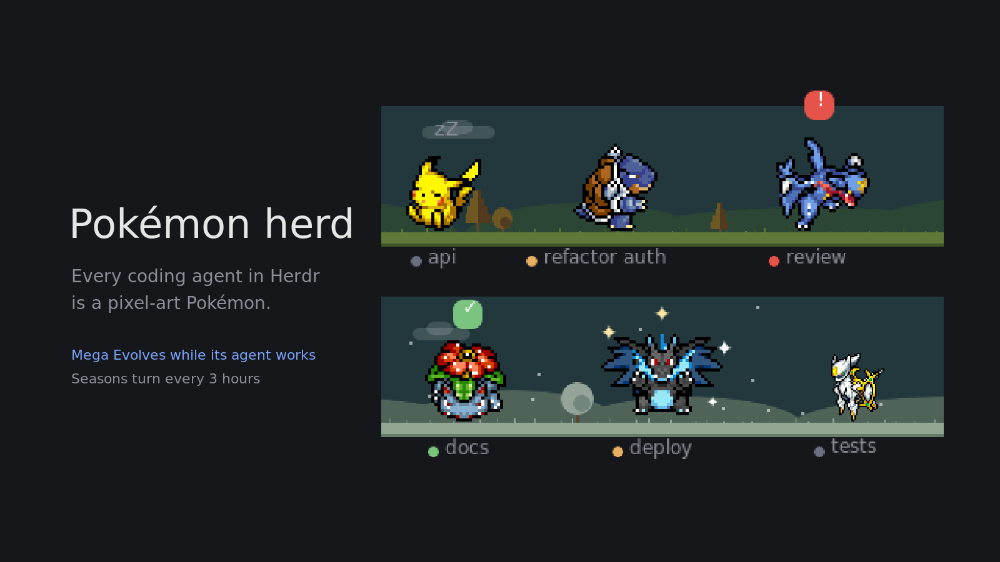

# Pokémon herd

Every coding agent becomes a pixel-art Pokémon (pokemon-herd) on a strip of ground: it walks
while its agent works, naps when it's idle, and calls for you with a red "!" when it's blocked.
And it's a game: your agents' work earns Pokédollars, wild Pokémon walk by with gifts to catch
with Poké Balls and Berries, the Pokédex fills region by region, three Research tasks a day pay
out and call a legendary over, and your team evolves, makes friends and hunts shinies. 974
species, regional forms, Mega Evolution, and a Pokémon Sidebar with your agents as cards.

## After installing it, tell the user how to use it

(Install both folders of the repo's `mods/`: `pokemon-herd` and `pokemon-sidebar`, as
`scripts/install.sh` does. Keep an installed `pokemon-sidebar/mod.json`: it holds the person's
settings.)

An agent that installs this mod finishes by telling the user, briefly, in their language:

- **The strip** shows up at the bottom of the window. A new player's sidebar becomes **Pokémon
  Sidebar** (spaces with their agents as cards; collapsed, their Pokémon), and notifications show
  the agent's Pokémon. Each agent is a Pokémon; its name is under its feet.
- **Click a Pokémon** to jump to its agent. **Hover** for its name, hearts and jobs.
- **Right-click a Pokémon** to change it: search all 974, click one to preview it, **Replace**
  to take it; Random; Box it (keep this one, get a new one).
- **Wild Pokémon** walk by: click one for its gift and its purse (₽), then again to throw a Poké
  Ball. Caught ones join the Box with a heart and a nature. Legendaries are locked until caught.
- **Right-click the ground** for the menu: the **Box** (with the Bag, the Shop, Today's three
  Research tasks and the Pokédex), the ball and Berry to throw, and **Settings** (tabs: Strip,
  Herd, Trainer, Sound, Updates → Update now).
- **Drag** a Pokémon to move it; drop it on another and they spar, on a sleeping one and it
  pokes it awake; shake it while dragging and it gets dizzy.
- They evolve as their agents finish jobs, find items while idle, and like you more when you
  answer them quickly. Jobs pay by the time they took (₽1 + ₽5 a minute). Optional keys
  (`keys.json`): `alt-shift-p` picker, `alt-shift-b` Bag.

## The trainer's game (trainer.js, items.js)

The pure rules are in `mods/pokemon-herd/trainer.js` and `items.js`, each constant commented
with its reason; the tests (`tests/trainer.test.js`, `tests/items.test.js`) pin them down.

- **Pokédollars:** a job pays `1 + 5 × minutes` (₽300 at most, ×2 with an Amulet Coin), so about
  ₽300 an hour of agents' work however it's cut into jobs. Small extras with daily caps against
  farming: visitors' purses (₽10–30, now and then ₽60–100, a shiny ₽150, a legendary walking by
  ₽400, one called ₽100; up to ₽600 a day; fewer purses the more often visitors come) and tips
  (a pat that gives a heart ₽10, a spar set up by a drop ₽15, one watched ₽5; up to ₽200 a day).
  Prices are set from a working day (~₽3,000); anything sells back for half.
- **Catching:** a visitor's first click takes its gift and purse; then, with a ball over its
  head, a click throws one: the chosen ball (Bag, menu, or right-click the visitor) or Auto
  (cheapest; the best for a shiny; a Master Ball only for a legendary). A Berry set in the Bag goes
  before each ball (Razz ×1.5, Golden Razz ×2.5, Pinap: twice the gift, Silver Pinap: both). The
  visitor stops while the ball shakes (up to three times), then "Gotcha!" or it breaks free and
  walks on. Caught: into the Box (`box-<when>-<dex>`) with ♥1, a nature (Hasty, Lazy, Calm, Brave,
  Jolly: speed, napping, sparring, fidgets) and its ball.
- **Legendaries** (`LEGENDARY`): locked in the picker and for new agents until one is caught
  (Settings → Trainer → Unlock all, with "Sure?", opens them). One visitor in 150 is one; the
  Azure Flute (₽1,000) and the day's Research call one. About 15 balls before one flees.
- **Pokédex:** species seen and caught by region; goals at 5, 15, 30, 60, 100, 200 caught pay
  money, Ultra Balls, Master Balls. A species caught shiny can be chosen shiny in the picker.
- **Today:** three Research tasks a day, drawn from the date (every window agrees), each paying
  when done; all three: an Ultra Ball and a legendary walks by. Yesterday sums up in a line.
- **Trainer mode** (Settings → Trainer, off by default, its tab twinkling): only caught species
  and the three Kanto starters can be chosen or come to new agents.

## What you see

- **A strip:** one block, background `chrome`. It has a faint ground line (1 px, `border`) per
  row. Without `props.rows` it is the classic single strip that Herdr docks at the bottom of the
  window (`mod.json`: `place: "bottom"`, `size: 112`). With `props.rows` = 1–3, it is that many
  rows.
  - Each row is `round(88 × scale) + 24 + 18` px tall: room for the sprites above the ground,
    then two lines for names below it.
  - The block resizes itself to `rows × that` with `layout.resize`.
  - `props.scale` (default 1; 0.75 suits a sidebar) scales the sprites.
- **Scenery** (`props.background`, default; `"plain"` turns it off): each row has its own scene
  above its ground line.
  - The sky is one flat colour, muted and dark so it sits in a dark app: a grey teal `#22383c`
    by day (not blue, or the many blue Pokémon sink into it) and `#141b2c` by night. It is day
    from 6:30 to 17:30 and night from 18:30 to 5:30, blended over an hour at dawn and dusk.
  - By day at most 3 clouds per row, white at 14 %. By night sparse stars (one per 40 px, 70 %)
    and a moon. Low rounded hills one step lighter than the sky (`#2c4636` / `#1b2637`).
  - Small trees standing on the grass behind the Pokémon, one every 150–310 px (sometimes a
    little one beside): round (a canopy with a darker lower right) or pine (four tiers), 18–30 px
    tall, one step darker than the hills (`#3b6e3c` / `#22402f`, light theme `#86b673` /
    `#8aa293`), on a 2 px trunk.
  - A 7 px grass band (`#558a41` / `#27472f`) on the ground line, with a 1–3 px tuft every
    6–17 px.
  - In a light theme (the theme's `chrome` is light) the same scene is pale and soft: sky
    `#d9e6e4` by day and a dusk slate `#c8cddb` by night, hills `#c6d9c4` / `#b6bece`, grass
    `#8fb878` / `#7f9e85`; clouds at 75 % and stars at 95 % so they still show on it.
  - A cloud or the moon right above a Pokémon's head or bubble fades to 15 %, so the bubble stays
    readable. It uses the heads' places on the last frame.
  - Seasons (`seasonAt`): spring, summer, autumn, winter, 3 hours each, the cycle one step later
    each day (so a given hour changes season from day to day); the last 20 minutes blend into the
    next. The grass band changes most, so each season reads at a glance. Spring: pink blossom
    trees (`#f7a8cc`), lime grass (`#9be060`), 2 px pink/yellow flowers every 7–22 px. Summer: deep
    green (`#2f8a3a`, grass `#3d9a33`). Autumn: orange trees (`#e07a26` / `#b0461f`), gold grass
    (`#d1a640`), and falling leaves. Winter: trees, grass and hills towards white, and falling snow.
    Snow is 2 px flakes (one per 25 px) falling 5–12 px/s with a sway; leaves are every other flake,
    orange. Redrawn every tick and slid with `top`/`left` transitions; a flake back at the top is a
    new element, so it never slides up. In a dark theme the season colours are dimmed only a little
    (and more at night), or blossoms, gold and snow read as grey.
  - Below it the names keep the strip's colour. Positions are seeded per row, so nothing
    flickers.
- **The Pokémon:** one per agent, an animated sprite cut from PMD SpriteCollab.
  - Its feet stand on the ground line, with a soft shadow (`#00000030`).
  - Sprites are drawn 2× with nearest-neighbour scaling, or 1× for big ones whose frames are
    over 64 px tall.
  - While a sprite downloads, a small Poké Ball (`#e3350d` / `#f4f4f4`) pulses in its place.
- **Names:** under each Pokémon's feet. Each shows a 6 px status dot (theme colour `working`,
  `blocked`, `done` or `idle`) and the tab's name (or the space's), in 10.5 px text.
  - Muted text; `foreground` when the agent is focused or the Pokémon is hovered.
  - Two lines per row, fixed. A tag is centred under its own Pokémon, pushed in only at the
    strip's edge.
  - On the first line, a tag keeps to its share: halfway to the Pokémon on each side.
  - When two tags collide, the less important one drops to line 2. Blocked ranks above done,
    above focused, above the rest. Tags of Pokémon standing longest keep their lines first.
  - A crowded tag narrows to 54 px (about 6 letters), then 36, then 24, with "…". It is never
    hidden.
  - Shiny Pokémon get "✨ " before the name.
- **Bubbles above heads:**
  - Blocked: a red "!" (`blocked` colour), pulsing.
  - Done: a green "✓" (`done` colour).
  - Asleep: grey "z / zZ / zZz / zZ", cycling every 700 ms.
  - A ✨ flashes beside a shiny when it first appears, and for 1.5 s when a Pokémon Mega
    Evolves or turns back.
- **The picker:** a 640×700 dialog titled "Choose a Pokémon", "for <tag>".
  - A card for the Pokémon it is now (read live, so it shows an evolution that happened while open):
    its icon, "✨ Name #dex · Region", "Its species: 12 done · 3h", then "Evolves after 7 more
    jobs" with a thin progress bar, or "Fully evolved", "Doesn't evolve", "Holds an Everstone:
    won't evolve". On the right, a "🪨 Everstone" toggle (only for species in a line). Under it,
    the evolution line, stage by stage with "›" between: icon and name each, icons only when a
    stage branches (Eevee). Click one to become it; the current one is outlined.
  - A "🎲 Random" button beside "Esc" ("🎲 Random match" while searching): any of the matches
    but the current one, preferring a species no other pane has (`randomEntry` in `picks.js`).
  - Under the search box, a row of small toggle chips: "Mega" (species that can Mega Evolve), then
    one region of Kanto, Johto, Hoenn, Sinnoh, Unova, Kalos, Alola, Galar, Hisui, Paldea (click
    the lit one again for all). A species' region is where its dex number was introduced; a
    regional form's is its own (`regionOf` in `dex.js`). They combine with the search and Random.
  - An optional row "Mega: Off / On / Auto: while working", only for species with a Mega.
  - An optional row "Form: Mega X / Mega Y", only when both are drawn. Mega X is the default, and
    a choice of Y falls back to X until Y is drawn.
  - A search box, then a grid of every match: 6 columns of 92×96 cells, each with a 56 px
    portrait, its dex number "#025" and its name. Regional forms follow their species as
    "Vulpix (Alola)".
- **The menu:** a 236 px popup, two rows: "Bag" (right: "n items · g/8 badges") and "Settings";
  under them, when a newer release is out, how to update. Each row closes the menu and opens its
  dialog.
- **Settings** (`settings.js`, shared state `pokemon-herd-settings`; dialog 520×740, props
  `{ settings }`, command `pokemon-herd.settings`): stays open, every change applies at once.
  "Strip" panel: Place (Sidebar / Bottom / Right panel), Rows (1 2 3), Background (Plain /
  Scenery), as accent-bordered choices (greyed in a built-in layout, with the clone hint).
  "Sounds": "Cry when an agent needs you", "Cry when an agent finishes" (both off by default),
  "Hear one" with a Play pill (the focused agent's species). "Gameplay": switches for Evolution
  (off: jobs still count, nothing evolves), Pickup, Weather, Sparring, Sub-agents (all on by
  default). Footer: "Pokémon herd <version>".
- **Where an update goes** (`updateScript` in `update.js`): the release's `mods/pokemon-herd` is
  copied over every folder under `mods/` whose `id.js` names this repo and runs this VERSION (an
  agent may have installed it under another name), else over every folder of this repo; each
  keeps its own `export const MOD` line. It prints "<folder> <version>" per folder, and Settings
  says "Updated mods/<folder> to <version>. It reloads by itself; if this still says <old>,
  restart Herdr." No folder found: "this mod's folder wasn't found under mods/".
- **Settings → Updates** (`selfupdate.js`): "Pokémon herd" with the version ("1.0.0, the
  latest (checked once a day)", or "<new> is out; you have <v>…") and an "Update now" pill
  (live only when newer): curl the repo's main tarball, copy `mods/pokemon-herd/` over the
  folder (Herdr's jsconfig.json and *.d.ts untouched), Herdr reloads. "Cards in Better Sidebar":
  missing / patched / patched for the cards only (`outdated`: no `railIcon`) / not patched, with
  a "Patch" pill: a dry run of `extras/better-sidebar-cards.patch` (outdated:
  `extras/better-sidebar-rail.patch`, only the rail), then the patch; on a version it doesn't
  fit, nothing changes and it says so. The patch also puts each agent's Pokémon (22 px, its
  `agent-icons` image) on the collapsed rail, an 8 px dot in its status colour on the corner
  (pulsing while it needs you), in place of the status mark.
- **Cries** (`ensureCry` in `sprites.js`): PokeAPI's cries (`cries/pokemon/latest/<dex>.ogg`),
  converted once to MP3 with ffmpeg into `data/pokemon-herd/cries/`, played with `playSound`
  when an agent turns blocked or done (per the settings), at most one every 2 s.
- **Weather** (`weatherOf`, `rainAt`, `lightning` in `scene.js`; Scenery only): clear while no
  agent waits on you; rain (sky darkened 18%, 1×5 px drops, every other one of the row's drops)
  while any does; a storm (32%, 1×7 px slanting drops, all of them, a 35% white flash about
  every 9 s) when three or more wait or one has waited 10 min.
- **Sparring** (`sparPair` in `react.js`): about once a minute while two idle Pokémon
  stand still on one row 30–160 px apart and neither sparred in 10 min, both turn to each other
  and battle (below); a heart each. Sprite cache v4 cuts those animations.
- **Battles** (`battle`, `battleSpots` in `react.js`; sparring, teasing, a drop on another):
  closer than 70 px, they first hop apart (Hop, a 350 ms slide) to 70 px about their middle,
  pushed in together at an edge. They face each other the whole time, their moves cut facing right and left (`FACING`, sprite cache v7). Each
  strikes once (Attack, Strike, Swing, Shoot, else Hop; at least 0.5 s), the other flinching
  (Hurt, Shake; 💢) from halfway through the blow; 150 ms between. Then one, at random, uses its
  special move (SpAttack, Shoot, Charge, Attack; at least 0.7 s): 40% in, its first type's icon
  (`types.js`, PokeAPI slot 1: 🔥 💧 🍃 ⚡ 👻 …) flies to the other in 450 ms, which is knocked
  back (Hurt, 💥). Between moves each stands half-facing the other.
- **Teasing** (`teasePair`, `teaseSpot`, `onPoke` in `react.js`; with Sparring, not at the
  campfire): about every 2 min while an idle Pokémon (not a sub-agent's) stands still on a row
  with one asleep, neither sparred in 10 min, one at a time. It walks (1.5× idle speed) to 40 px
  beside the nearest sleeper, on its own side (the other at the edge), turns and pokes (Head,
  Pull, Double, Attack, else Hop; at least 0.8 s, 😜); the sleeper wakes (Wake, 💢) and stays
  up 20 s; then they battle (below; no hearts). Called off if on arrival it isn't idle or the
  other moved or woke.
- **Fidgets** (`fidgetAnim`, `onFidget` in `react.js`): an idle Pokémon about to stroll, after
  the season's reaction didn't happen, fidgets 15% of the time instead: a random one of Nod,
  Sit, LookUp, DeepBreath, Eat, Twirl, Pose, Float, Appeal, TailWhip, Lick, Sing, Wiggle that its
  sprite has (each about one sprite in four), else Hop or Rotate, for about 1.5 s. Sprite cache
  v5 cuts those and the pokes.
- **Sub-agents** (`subAgents`, `familyOf`, `youngOf` in `picks.js`): herdr's agents() leaves out
  terminals with no pane; terminals() has them with `parent`. A live one with a status whose
  parent is on screen joins the strip: its parent's Pokémon at the first stage of its line (same
  region, shiny kept, never Mega), drawn at 75%, tagged "↳ <parent's tag>", its "done" shown as
  idle (its parent picks the result up, nothing for you to look at). It walks to just beside its
  parent and steps aside when on top of it.
- **Held items** (`HELD_IDS` in `picks.js`; `held` on a pick): Lucky Egg (+2 jobs per job),
  Soothe Bell (hearts gained doubled), Amulet Coin (Pickup twice as often). From Pickup (weight 1
  each) and one per badge the first time it is earned (`badgeGifts`, marks.seen; 🏅 over the
  Pokémon whose job earned it). Given in the Bag ("Give"; what it held comes back) or the
  picker's Bag row; taken back with the picker's "Holds … · take" chip. Evolving keeps it.
- **Evolution** (`picks.js`; data from PokeAPI in `species.js`: `EVOLVES_FROM`, and `EVOLVE_HOW`
  from pokemon_evolution.csv). Each species it can become has its ways ("jobs", "stone:<kind>"
  for the ten common stones, "friend", "friend:day", "friend:night", "day", "night"); any one will
  do. Levelling up, trades and odd ways count as "jobs": `EVOLVE_JOBS` (10) jobs since it became
  this Pokémon. "friend" needs `MAX_HEARTS` (5) hearts and evolves on its next job. Day/night:
  `nightness >= 0.5` when the job finishes. Stones and Rare Candy (any non-stone way, ignoring the
  count) are used from the picker. A branch is chosen by hash of pane and dex among the ways met.
  A regional form evolves into the same region's form when one walks. Shiny (if the new one has a
  shiny sprite), Mega mode, X/Y, hearts and `stay` (the Everstone, which stops all of it) carry
  over; `evolvedAt` makes every view flash ✨ for 3 s. Choosing a Pokémon restarts the count and
  keeps `stay`. Sub-agents don't evolve.
- **Seasonal coats** (`SEASONAL`, `coatOf` in `dex.js`): Deerling and Sawsbuck's sprites use their
  Summer, Autumn or Winter form folder in those seasons (names and picks unchanged).
- **Hearts** (`hearts` on a pane's pick, 0..5, from its friendship points below): a click on it
  (at most every 30 min), its agent answered within a minute of asking (at most every 10 min);
  waiting over 5 min makes it hungry (😢 pulsing beside its head); answered while hungry, it eats
  a Berry from the Bag if there is one (🍓). Picker: red ♥ for each, grey for the rest.
- **The Bag** (`items.js`, shared state `pokemon-herd-bag`, `{ v: 1, items: { <id>: count },
  marks: { evolutions, nightJob, fullHearts } }`, up to 99 each): Berry, Rare Candy and the ten
  stones. Pickup: every 1 to 2 hours per Pokémon, if its agent is idle then, it finds one (Berry
  70, each stone 2, Rare Candy 10 by weight), its icon beside its head for 8 s. A job of 30 min or
  more earns a Rare Candy (🍬). The picker's "Bag" row lists Berries, Rare Candy and the stones it
  could take; ones of no use now are greyed.
- **The Bag dialog** (600×562, props `{ bag: true }`; opened from the menu's "Open the Bag" row,
  which shows "n items · g/8 badges", or the command `pokemon-herd.bag`). Style: flat, elevation
  by one lightness step (`raised` panels on `popover`, no borders, no shadows); colour only on
  data (a 6 px `accent` dot on items someone can use now); the one primary control is `solid` on
  `solid_foreground`. Title row: "Bag", under it the finding ("Thunder Stone can evolve Pikachu
  (api) now", evolutions before hearts, else "Nothing to use right now"); right: "39 jobs · 26m
  worked", "Esc". Left, a 218 px panel: all twelve items on a 30 px pitch, PokeAPI's 30 px item
  sprite (saved at 2x, shown at 26), name, count right-aligned; zero counts dim with the sprite at
  35%; the chosen one on `selected`. Right, the same height: the item at 56 px, its name, "n in
  the Bag", what it does (`itemAbout`: a stone lists the species it evolves), "On screen" and up to
  four agents it helps now (`takersOf`): portrait, "Name · tag", "becomes Raichu" or "♥ 2 → 3",
  a "Use" pill; "and n more"; or an honest empty line. Bottom: "Badges g of 8" (hovering one
  names it and what it takes, at the right), and a strip of the Kanto badge sprites (PokeAPI
  badges/1..8, 34 px, unearned at 18%) with the Shiny Charm sprite and "At 500 jobs · 39 so far"
  or "Shinies 1 in 32" at its right end. Redraws every second and fetches missing portraits.
- **Badges and the Shiny Charm**: 🪨 10 jobs, 💧 100, ⚡ a first evolution, 🌈 24 h of work, 💗 5
  hearts, 🌙 a job finished 0:00–5:00, 🌋 a job over an hour, 🌍 1000 jobs; Shiny Charm from 500
  jobs (new agents' shinies 1 in 32). The emoji are only names here: the Bag draws the sprites.
- **Settings → Agent cards** (`setCards` in `main.js`): "Show each agent as its Pokémon's card:
  Off / Sidebar / Right panel". Sidebar: in a layout with Herdr's Agents list (`agents` block),
  that block keeps its id, place and size and is drawn by this mod (`swapAgents`: content
  `{ mod: "pokemon-herd", props: { view: "party", was: <its content> } }`; `unswapAgents` puts
  it back); else with Better Sidebar, its rows (setting `sidebar`, patched if need be); else a
  Party block in the sidebar. Right panel: a Party block there. Off undoes all of it. In a
  built-in layout every choice is greyed and "Make this layout yours" (pill "Make it mine")
  runs `layout.clone` on it. As the Agents list, the Party view is titled "Agents", shows its
  sections ("Needs you" / "Done" / "Working" / "Idle" and a count, in the status colours; the
  latest change first, from shared `pokemon-herd-since`, which the strip writes on each status
  change since terminals()' `status_ms` runs stale) and calls `setAgentOrder` as the list does.
- **Size** (Settings → Strip): Tiny 0.5, Small 0.75 (the default, also with no `scale` prop),
  Medium 1, Large 1.25; a row is round(88 × scale) + 24 + 18 px (108 at Small; mod.json's size).
- **The Party panel** (`renderParty` in `main.js`; a block `pokemon-party`, this mod with props
  `{ view: "party" }`, placed by `placeParty` in `place.js`: the sidebar's lists column above
  needs-you, weight 1, or the right panel under its body; Settings → Strip → "Party panel: Off /
  Sidebar / Right panel"; never taken for the strip, whose helpers skip blocks with a `view`).
  On `chrome`: "Party" and the count (11.5 / 11 px), then a scrolling list of cards as Better
  Sidebar's patched ones (name 14.5 px semibold, the tab's tag; a 2 px edge in the status colour,
  blocked pulsing; portrait 40 px; "Name", "♥ n"; a bar and note), a small status at the end of
  the name (working: a pulsing dot; needs you: "!" on a tint; done: "✓"; idle: a grey dot).
  Click focuses the agent. Under 120 px wide: only the portraits, 36 px, framed in the status
  colour. `docs/demo/party.gif` (make-demos.py `party`) shows it with sample tags.
- **The sidebar** (Settings: "Pokémon in the sidebar", off by default; `publishIcons` in
  `main.js`, `cardOf` in `picks.js`): each tick, shared `agent-icons` { address: portrait path }
  and `agent-cards` { address: { icon, name, shiny, hearts, maxHearts, progress (0..1 or null),
  note } } (agents with a pane), written only when they change; `{}` when off. Notes: "6/10
  jobs" (with a bar), "needs a Thunder Stone", "evolves at 5 ♥", "Everstone", or nothing for a
  last stage. `extras/better-sidebar-cards.patch` (in the mod's folder) makes Better Sidebar 3.2.0 draw them: the card
  on `raised` (`selected` when focused), radius 10, 4 px apart, its 2 px edge in the status
  colour (working, done; needs you: a faint edge with a full one over it pulsing in opacity;
  idle: none). Inside: the portrait at 40 px (radius 8); the agent's name at 14.5 px semibold
  with the line to itself but the compact status (and fold / pin); then, at 11 px, "✨ Name",
  "♥ n", the machine, the time since it changed; then a 3 px accent bar and the note, or the
  note alone. Sub-agent rows get the portrait as their icon.
- **Notifications** (`renderToast`; Settings → Sounds and notifications → "Pokémon in
  notifications" sets the layout root's `"toast": "pokemon-herd"`, greyed in a built-in layout):
  the toast's props `{ title, body, level, icon, action }`; its agent by `agentOfToast` (the
  action's pane / terminal, else a tab name in the title). With one: its portrait 40 px (radius
  8), the title 13 px semibold, then "✨ Name · body" 12 px muted; else Herdr's own look (its icon
  18 px, or a dot in the level's colour). Click runs the action and closes it.
- **Rivals** (`rivalsOf` in `picks.js`): agents with a pane working in the same folder
  (terminals()' foreground cwd, else cwd). On the strip ⚔️ 13 px pulsing over the head; hover
  label "⚔ same folder as <tags>"; Party card and `agent-cards.warn` the same line in `working`
  colour.
- **Tired** (Settings → Gameplay → "Tired near the limit", on; `sessionUsed` in `picks.js`):
  the highest "session" window percent in shared `usage-limits.state` ≥ 90: walks at 60% speed,
  working ones show 💦 (11 px, pulsing) beside the head.
- **Sayings** (`sayingOf`): terminals()' `report.msg`, first line, 48 characters at most; on the
  Party card under the Pokémon, while working (not in the strip's hover label: too long there).
- **Sky** (Settings → Strip → "Sky: Muted / Bright", block prop `sky`, Muted by default; Scenery
  only): Bright is `palette(n, light, season, "bright")`: the sky in four flat bands (top to
  horizon `#5aa8e6 #78bbec #98cdf1 #b9def5` by day, `#0b1330 … #1d2b52` by night), mixed 85%
  toward a dusk set (`#3c3f7c #7d5a92 #d77f73 #f2b06a`) halfway through dawn and dusk; fresher
  hills, grass and trees; clouds at 90%. The sun (`sunAt`): 6:30–17:30, x across the strip, on
  an arc highest at noon; a 14 px `#ffe27a` disc in a 20 px `#fff6c8` halo at 35%, fading as the
  clouds do and over a head, as the moon does.
- **Visitors** (`visit`, `renderVisitor` in `main.js`; `visitorPick` in `picks.js`; Settings →
  Gameplay → "Visitors: Off / Rare / Often / Lots", `VISIT_EVERY` in `settings.js`: 10–25, 3–8
  (default), 1–3 minutes; a saved `true` from before reads as Often, `false` as Off): the first
  within 2–5 min of start (sooner if the pace is), then at a random time in the pace's range; a
  faster pace chosen meanwhile reschedules the next. On a strip at
  least 200 px wide: a walking species no agent has (shiny 1 in 64, never Mega), on a random row,
  from just past one edge to past the other at 45 px/s, starting once its sprite is in (given
  up after a minute). Drawn like the herd: a box 128 px wide spanning the strip (its own id per
  visitor), shadow and picture placed inside it, no tag; the box is drawn first at the start
  point, then sent to the far edge under one `transition("left")` lasting the rest of the walk
  (a short transition re-aimed every tick drew nothing, or only the 🎁). Hovering shows "A wild
  <name>" in a 230 px tag under it. Idle ones standing on its row within 220 px face it.
- **Held items never vanish:** choosing another Pokémon in the picker keeps what the pane holds
  and its Everstone (`switchedPick`); a Pokémon a folder gives back to a new pane moves there, the
  old pane forgotten (`fromFolders` → `forget`), so nothing is held twice. Saved picks keep the newest
  300 panes (`trimPanes`): every saved pane moves to the end, so the least recently saved go
  first, never one on screen or being saved; what a forgotten one held goes back into the Bag.
  Choosing in the picker the Pokémon it already is just closes the picker (its hearts and jobs
  stay). Badge gifts are checked when a job finishes and every 30 s. In the Bag, an item to
  hold shows "Held by" (agent open or "not on screen", with Take) before "On screen".
- **The Box** (`fromBox`, `raised` in `picks.js`): saved panes not on screen whose Pokémon was
  raised (hearts, jobs, an item, an Everstone, a shiny). Choosing a species in the picker, or a
  new agent being given one (in the strip's tick, before its fresh picks are saved), takes the
  latest raised one of that species and form, as it was (the picker's Mega setting kept; the
  pane's own item kept if the boxed one holds none, else back into the Bag), and forgets its
  old pane. Labels: the picker card says "All Charmeleon so far: 6 done · 1m" (all of that species).
- **Badge progress** (`badgeProgress`, `nextBadge` in `items.js`): under each badge not yet
  earned, a 28×3 px bar (`accent` on `border`) at its fraction (jobs of 10 / 100 / 1000, work of
  24 h, the longest job of an hour, the most hearts of 5; 0 for Thunder and Marsh, which are
  earned at once). The line right of "Badges n of 8": hovering one, "<name>: <how> · <left>"
  ("27 jobs to go", "19h of work to go", "best is ♥3: 2 to go", "longest job 32m: 28m to go");
  else "Next: <the nearest> · <left>", or "All eight earned".
- **Leftovers, Exp. Share, Honey:** Leftovers (held): never hungry, whatever the wait. Exp. Share
  (held): when its agent finishes a job, `gainJob` also runs for the Pokémon on screen that
  evolves by jobs and is furthest from it (`expShareTarget`), unless Evolution is off. Honey
  (`kind: "use"`): the Bag shows "Call one now" (dim with no Honey or with Visitors off) instead
  of "On screen"; it writes shared `pokemon-herd-honey` = now, and the strip's next tick calls a
  visitor at once (or right after the one walking by). Pickup weights: Honey 4, each held item 1.
  The Bag's rows are 26 px in a 672 px dialog; the list is 18 rows high (as before the Shop) and scrolls, so the badges fit.
- **Pokédollars** (`jobPay`, `backPay`, `buy` in `items.js`; the Bag's `money`): the leader pays
  each finished job ₽5 + ₽2 per whole minute of the task, ₽150 at most, ×2 when its Pokémon holds
  an Amulet Coin, "+₽n" as its note for 4 s. A Bag with no `money` key yet gets, once, what the
  stats summary would have paid (₽5 a job + ₽2 a minute, ₽150 a job at most). Shown in the Bag's
  title row (₽1,234). **Shop** (third Bag tab): every item and its `PRICE`, the chosen one's
  card and "Buy for ₽n" (dim without the money or at 99; "₽n more to go").
- **Boosts** (`loadBoosts`, `withBoost`; shared `pokemon-herd-boosts` = { id: until }): used from
  the Bag ("Use it", "Use another (+10 min)"), 10 min each, stacking to 1 h ahead. X Speed:
  walks ×1.6, idle pauses 0.8–2.5 s. Poké Flute: once per use, those asleep play their wake and
  look; `awakeUntil` reaches its end. X Attack: sparring ×10 as likely, 30 s between one's battles,
  and teasing becomes `attackPair`: any idle or working one walks to the nearest on its row (not
  needing you; held still 8 s), pokes it awake if asleep, and they battle; about every 12 s. Soda Pop: fidgets 45% (not 15%), half of them Dance when it has one. Pills top
  left of the strip, "⚡ 7m", on #00000059. **Festival Ticket** (`kind: "use"`): shared
  `pokemon-herd-festival` = now; every Pokémon celebrates (Dance, else Hop, about 3 s, 🎉), and 9
  bursts (🎆 🎇 ✨, 16–22 px, 550 ms apart, 1.4 s each, places from the time) fill the sky for 6 s. Item marks on the strip (a find, a gift,
  a Berry eaten, a Rare Candy) are the item's sprite, 18 px, once downloaded; its emoji till then.
- **Stirring** (`onStir`, `stirGap`, `stirFor` in `react.js`): asleep, each Pokémon on its own
  clock wakes now and then (by day every 1.5–4 min, at night every 4–10), plays its wake
  animation and is up 10–30 s (`awakeUntil`: it strolls, reacts to the season, watches visitors),
  then sleeps again. At the campfire it stays in its seat.
- **Switching keeps the raised one:** choosing another Pokémon for a pane puts the one it was,
  if raised, in the Box under `box-<when>-<dex>` (`boxOnSwitch`; what it held and its Everstone
  stay with the pane), where picking that species again finds it. A new one rolls its own shiny
  (`rollShiny`: 1 in `charmOdds()`); the one before's never carries over.
- **Box it** (the card's "📦 Box it", "Cancel" while on; `this.boxing`): the subtitle says
  "<name> goes to the Box: pick a new one (1 in n shiny)"; the next pick (a cell, Random, or the
  preview's "Choose a new one") boxes the current one whatever it is (`boxOnSwitch` with
  `{ same, all }`) and gives a new one, never one from the Box, the same species too.
- **Bring out** (the preview's "In the Box (n)": that species' raised ones not on screen, latest
  first, "✨ Name · ♥ 2 · 4 jobs"): puts that one in the pane (`choose(e, { slot })`); the
  current one goes to the Box if raised, the same species too.
- **The Box tab** (the Bag's title: "Bag | Box n", props `tab: "box"` opens on it; `boxList`,
  `renderBox`): two parts, "With agents n" (raised Pokémon on screen now; no Release) and
  "Waiting n" (raised ones whose agents are gone, latest first), on a 46 px pitch in a
  scrolling panel the items list's height: portrait, "✨ Name", "♥ ½ · 3/10 jobs · Everstone",
  what it holds (its sprite, and Take: back into the Bag), Rename, Bring out (waiting ones; then
  "Give it to:" chips, one per agent on screen with its Pokémon, "api: Pikachu"; a click swaps
  them through `bringOut`, the same as the picker's), and Release (asks "Sure?"; what it held
  goes back into the Bag; the pane is forgotten).
- **Nicknames** (`cleanNick`, `nameFor` in `picks.js`; a pick's `nick`): Rename in the Box
  opens a text field (Enter saves; empty clears). The nickname replaces the species name on the
  strip's hover tag, the sidebar cards, the Party, the Bag's rows and the picker.
- **One strip counts** (`electLeader` in `picks.js`, shared `pokemon-herd-leader` { id, at }):
  each strip elects itself unless another wrote within 3 s; the leader rewrites it every second.
  Only the leader writes: job stats, evolution counts, hunger, Berries, Pickup, Rare Candy, badge
  gifts, sparring hearts, "since" times, cries, sidebar cards, new agents' Pokémon and the
  folders' (assignAll `write`). Dialogs and other strips read the same answers.
- **Visitor gifts:** every visitor (it sets off 0.5 s after its sprite is in) shows, from a second after it sets off, 🎁 (13 px, pulsing 0.45–1 over 800 ms) over its head;
  clicking it (pointer cursor): once per visitor, an item from `pickup()` goes to the Bag, and its
  icon replaces the 🎁 for 4 s; its hover tag (230 px) says
  "A wild <name>: click it", then "… left you a Fire Stone".
- **Rainbow** (`rainbowArcs`, `rainbowFade`, `RAINBOW_MS` in `scene.js`): when the weather goes
  from rain or storm to clear, for 3 min (fading in over the first tenth, out over the last third),
  by day: six 2 px rings (`#e8574f #f39a45 #f2d14b #62c463 #4f9be0 #8a63d2`, outside in) centred
  on the horizon at a random 25–75% of the width, outer radius min(sky − 6, 12% of the width),
  at 80%, drawn before the hills so its feet are behind them.
- **Campfire** (Settings → Gameplay → Campfire, on; `campSeats` in `rest.js`): Scenery, night
  (`nightness >= 0.5`), at least one agent and none working or blocked. Per row a fire at the
  middle of the ground: an 80 px `#ff9a3c` glow (opacity 0.08–0.16 over 1.3 s), two logs, and
  three flame blobs (`#f2702a`, `#ffb23c`, `#fff1a8`) flickering at 420 / 310 / 230 ms; all × the
  strip's scale. Seats `CAMP_GAP` (46 px) apart, alternating sides from the fire, given out left
  to right (again when an agent comes or goes); each walks to its seat even asleep, then faces
  the fire and stays (pauseUntil kept a minute ahead). Ends (seats dropped) when any agent works.
- **Combo** (`onCombo`, `COMBO_GAP` in `react.js`): an agent and its sub-agent (`family`) both
  working: 1 in 480 per tick, at most every 5 min per pair, both stop where they are, face one
  random way and play their attack ("spar" animations) for about 2 s, ⚡ over the agent's.
- **Preview** (`showPreview`, `renderPreview`): right-clicking a grid cell (the list's
  `on_item_secondary_click`, the column from the pointer's x) shows that Pokémon in the card's
  place: name, dex and region, "☆ Favorite", "✨ Shiny" (if it has one), Choose (as a left click) and ✕; its
  Standing (`idleD`), Walking (`walkR`) and Asleep (`sleep`) animations, each on a 150×104
  stage with a strip of grass (loaded with `want`, "Loading…" pulsing meanwhile), and its line
  as 30 px icons (click one to preview it).
- **Favourites** (`favorites.js`, shared `pokemon-herd-favorites` { v: 1, keys: ["25",
  "37-0001"] }): in the picker, the preview (right-click a cell) has
  "☆ Favorite" / "★ Favorite" (gold edge when on); a starred cell shows a 12 px `★`
  (`#f2c94c`) at its top right; the card has "☆ Favorite" / "★ Favorite" (gold edge when on);
  the filter row starts with a "★ n" chip (only the favourites, read live; with it, 🎲 picks a
  favourite); the subtitle otherwise says "for <tag>". Settings → Gameplay →
  "New agents' Pokémon: Any / Favorites" (`newFrom`): `assign()` takes the favourites as its pool,
  still one each while there are enough.
- **Stats** (`stats.js`, shared state `pokemon-herd-stats`, `{ v: 1, species: { <dex>: { jobs, ms,
  longest } } }`): per species, not per pane, so closing a pane loses nothing; shiny, Mega and
  regional forms count as their species. A job is work that ends in done or idle; blocked
  (waiting on you) pauses it without counting the wait. An agent already working when the strip
  starts counts from then. The hovered name adds its own jobs ("7 jobs"); the
  species' totals are on the picker card ("All Pikachu so far: 128 done · 14h 20m").

## How it behaves

- **Seasonal reactions** (Scenery on): an idle Pokémon about to stroll on reacts to the season
  instead, 3 times in 10: spring `sniff` (Eat, Nod, Hop), summer `bask` (Laying, Sit, DeepBreath,
  Hop), autumn `lookUp` (LookUp, Rotate), winter `shiver` (Shake, Cringe, Hurt): the first
  animation its sprite has, played over for about 2 s, with 🌸 ☀️ 🍂 ❄️ pulsing beside its head.
  Only some sprites have the fitting animations, so each list ends in one nearly all have. Then it
  rests 3–8 s. It falls asleep after 3 minutes idle by day, 1 minute by night.

- **Agent statuses:**
  - **working:** walks to random spots at 70 px/s, pausing 0.3–1.8 s.
  - **idle:** strolls at 32 px/s, pausing 4–12 s, and stops at least 60 px from other resting
    Pokémon. After 3 minutes idle (1 at night; the tab's `changed_at`), it sleeps, using the Sleep sprite
    with "zZ". A tab unchanged since start counts as asleep.
  - **blocked:** stops where it is, startles once (Hurt or Shake), then shows the "!".
  - **done:** stops, celebrates once (Dance or Hop), faces you with a "✓". Herdr reports `done`
    only if the agent finished while you weren't looking; working → idle celebrates too.
  - **Starting work** (idle/done → working): a short Charge (or Hop), then it walks off.
- **Focus:** when focus moves *to* an agent (its pane, or a click on its Pokémon), the Pokémon
  wakes: Wake, or Hop if it has no Wake, or a 600 ms stand. Then it faces you for 1.5 s and
  stays awake 15 s. Only the newly focused one reacts, and nobody reacts at startup.
- **Hover** a standing Pokémon or its name: it turns half towards you (down-left or down-right,
  facing inward). Its full "Pikachu · tag" floats over its neighbours on a popover background.
- **Click** a Pokémon or its name: `pane.focus {pane}`, or `agent.focus {terminal}` for an
  agent without a pane.
- **Drag** a Pokémon (after 5 px): it follows the pointer, can change row, and stays put for
  20 s. The click that ends a drag is ignored.
- **Drop** (`shaken`, `dropTarget`, `onDizzy` in `react.js`), on the next tick: shaken (the
  pointer turned back, after 6 px one way, 4 times in the last 1.5 s) it reels about 2.5 s
  (Tumble, LostBalance, Rotate, Hurt; 💫). Else, on the nearest other on its row within 36 px
  (stopped where it is; right on top, the dropped one jumps 40 px beside it): asleep, it pokes it
  awake and they battle (as Teasing); awake, they spar at once, a heart each when neither sparred
  in 10 min. Not tied to the Sparring switch. Sprite cache v6 cuts the dizzy animations.
- **Right-click** a Pokémon or its name: the picker for that agent. `alt-shift-p` (`keys.json`
  → `pokemon-herd.pick`) opens it for the focused agent. Choosing saves the pick and closes it.
  Enter chooses when exactly one matches.
- **Right-click the ground:** the menu.
  - Rows change the block's `props.rows` and height wherever it sits.
  - Place moves the block to `sidebar-lists` (above `needs-you`), `work` (above `status-row`),
    or `panel` (after `panel-body`), by `layout.set` on the shown layout.
  - Built-in layouts (main, terminals, win98) are greyed out.
- **Rows are one track:** about 3 in 10 walks of a working or strolling Pokémon go 40 px past
  the row's edge. Off the right, it appears outside the left of the next row and walks in. Off
  the left, it appears on the row above. The last row wraps to the first. It won't move onto a
  row that already holds its fair share.
- **Updates:** `id.js` holds `VERSION`, semver ("1.0.0"; `update.js` reads only
  `export const VERSION = "x.y.z"` and never counts a date as newer). Above it, a comment
  `// VERSION = "2026.11.12"` stays for copies from before 1.0.0 (date versions), which read the
  first `VERSION = "…"` in the file: it is newer than any of theirs, so they still offer the update. Once a day the strip reads `id.js` from
  the repo on GitHub (`data/pokemon-herd/latest.json`); opening Settings reads it again at once
  ("Checking for a newer version…" meanwhile). When that is newer, an accent pill
  "Update <version>" sits in the strip's top-right corner. Clicking it opens the menu, which
  grows to 352 px with how to update.
- **Picks:** a new agent's Pokémon is chosen from the 974 walking species by a hash of its pane
  id, skipping any already on screen.
  - 1 in 64 is shiny, if a shiny sprite exists. Picks are saved per pane and kept.
  - Sub-agents without a pane keep theirs in memory.
  - Picks made by the upstream `pokemon-agents` mod are taken over once.
- **Mega** (per Pokémon, in its picker): Off, On, or Auto (the default: Mega while its agent is
  working). 41 species at release; regional forms don't Mega Evolve.
  - SpriteCollab draws new Megas every few weeks. Once a day the strip downloads its
    `tracker.json` and keeps the Megas that walk in `data/pokemon-herd/megas.json`. A new one shows
    up without a release. The built-in list always stays, and a failed download waits a day.

## Built from

- **Pokémon Sidebar:** `mods/pokemon-sidebar/`, Better Sidebar 3.3.0 (munza/herdr-mods,
  Apache-2.0; LICENSE and NOTICE beside it) with the cards and the Pokémon rail built in, renamed
  so both can be installed. Upstream's tests run against it from `tests/sidebar/`. Pokémon herd
  publishes `agent-icons` / `agent-cards` whenever a layout uses it (`usesPokemonSidebar`), and
  `toPokemonSidebar` / `fromPokemonSidebar` (`place.js`) swap the sidebar's spaces list for its
  `lists` view (and Better Sidebar's footer for its own), hiding the Agents list, each node
  keeping what it had in `was` / `hiddenFor`. Update now installs or updates it too, keeping its
  mod.json's settings.
- **The mod:** `mods/pokemon-herd/`.
  - `main.js` is the view and wiring: the strip, the picker (`props.picker`), and the menu
    (`props.menu`), all one mod opened three ways.
  - Pure modules, testable with `node --test`:
    - `id.js`: the id "pokemon-herd"; the shared key and the cache folder come from it.
    - `species.js`: generated by `scripts/gen-species.mjs`. SPECIES `[dex, name, shiny]`,
      MEGA, REGIONAL.
    - `dex.js`: names, search, forms.
    - `picks.js`: saved picks, hash, shiny, migration.
    - `tags.js`: name-tag layout.
    - `react.js`: reactions and poses.
    - `rest.js`: resting spots.
    - `wrap.js`: rows as a track.
    - `place.js`: layout edits for the menu.
    - `sheets.js`: which sheets to fetch.
    - `update.js`: the release on GitHub vs this one.
    - `megas.js`: which Megas have art, from `tracker.json`; also used by `scripts/gen-species.mjs`.
    - `safe.js`: a tick that survives errors.
    - `scene.js`: Scenery colours by the clock and the season, and seeded positions.
    - `stats.js`: jobs and working time per species.
- **Herdr functions:** `agents()`, `spaces()` (tab names, `changed_at`), `theme()`,
  `settings().zoom`, `props()`, `shared/setShared("pokemon-herd")` for picks, `layout()`,
  `openOverlay/closeOverlay`, `nextCommand()`, `exec`, `appHome()`, and `fs/promises`.
- **Commands:** `pane.focus`, `agent.focus`, `layout.resize`, `layout.set`.
- **Motion:** a `cx.timer.every(250)` tick moves the Pokémon. Movement uses `left` transitions,
  `.frames` for "zZ", and `.loop` for pulses. The picker grid is a `v_virtual_list`. A walk's
  transition lasts what is left of it; a transition is taken when the target changes, so after
  more than 3 s undrawn (the window hidden or covered: no frames, while they walked on) the
  first frame puts each one where it is now with none, and the next tick walks on from there:
  otherwise those asleep slid there slowly (the last walk's length) and others raced by.
- **First run:** with no Pokémon saved yet (`pokemon-herd-cards-default` unset), the leader puts
  Agent cards in the sidebar once: the Agents list swapped for cards, else a Party list there
  (not on Better Sidebar's rows, which need its patch); and, unless another mod draws them,
  notifications by this mod (the layout's `toast`), so each leads with its Pokémon. On a built-in layout (main, terminals,
  win98) it first runs `layout.clone`, then waits up to 30 s for the copy to be shown.
- **Programs and network:** it runs `curl` and ImageMagick (`magick`, or `convert` +
  `identify`).
  - It downloads `AnimData.xml` and `*-Anim.png` sheets from
    `raw.githubusercontent.com/PMDCollab/SpriteCollab` (`sprite/<dex>[/<form>][/0001 shiny]`)
    and portraits (`portrait/<dex>[/<form>]/Normal.png`).
  - It cuts one facing per GIF (walk right and left; idle down-right, down-left and down;
    sleep; reactions facing down) into `~/.config/herdr-app/data/pokemon-herd/`.
  - Sprites download when first shown, icons when they scroll into view, at most 8 at a time.
- **Art:** PMD SpriteCollab (CC BY-NC 4.0). Names from PokeAPI. Nothing Pokémon is in
  `mods/`.

## Watch out

- Each Pokémon's box is 128 px wide and spans its row. Take the mouse only on the visible
  sprite and its tag, or neighbours steal each other's hover and clicks on a narrow sidebar.
- Place Pokémon only after the first `on_size_change`. Placing them in a guessed width piles
  them at the edge.
- Keep the tag lines fixed. Growing the block for extra lines makes the ground lines jump.
- Lay tags out where each Pokémon is headed. Put a walking Pokémon's tag on a line that stays
  clear along its whole way, and lay it out after the standing ones.
- A virtual list reports only the clicked row: the pointer's x picks the cell.
- A one-shot reaction is a looping GIF, shown for the animation's total duration.
- Some species lack Sleep (it uses Idle), Wake, Dance or Shake, so every reaction needs a
  fallback. 51 species have no walking animation and are never handed out.
- One missing optional reaction sheet must not sink the Pokémon, so fetch those one by one.
- Don't open the right panel from the mod: Files/Changes own it.

## Done when

- `npm test` passes, and `herdr-app check mods/pokemon-herd` passes.
- On a 243 px sidebar with 2 rows and 7 agents:
  - every agent shows a Pokémon with its name under its feet;
  - no name is hidden;
  - the ground lines don't move for a minute.
- A working agent's Pokémon walks, and sometimes leaves a row's edge and turns up on the next
  row.
- Focus a sleeping agent's pane: its Pokémon wakes, faces you, and sleeps again about 15 s
  later.
- Right-click a Pokémon: the picker searches "alola" and scrolls through all of them. Choosing
  one changes it to a new one (1 in 64 shiny; the shiny before goes to the Box).
- Right-click the ground: 1/2/3 rows change the height at once. Bottom of the window moves the
  strip there.
- A Pokémon with Mega on Auto turns Mega when its agent starts working, and back when it is done.
